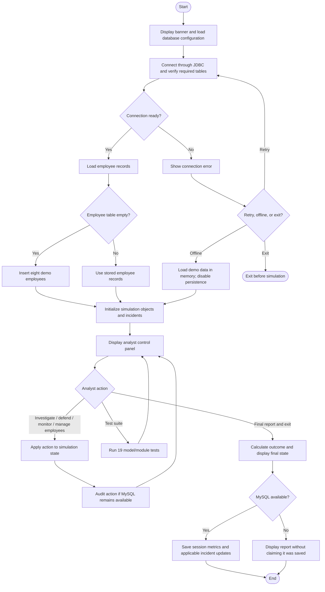
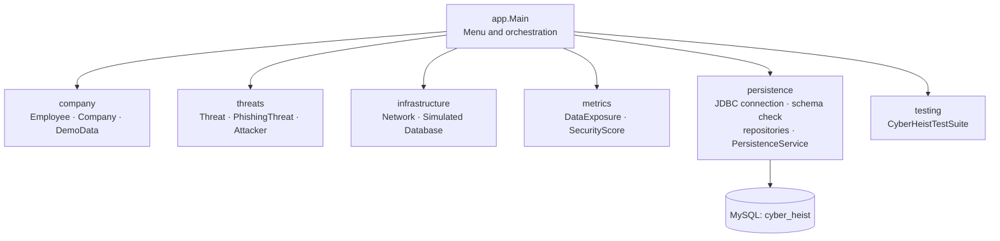
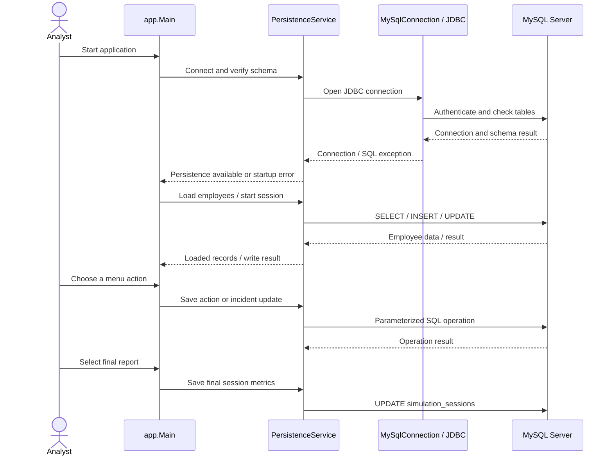
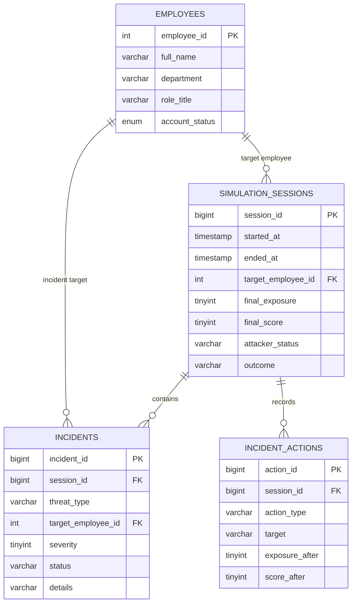

<div align="center">

# CYBER HEIST
### Threat Hunters · Java OOP Cybersecurity Incident Simulation

**A console-based incident-response simulation for NEXA Technologies**


*Investigate fictional threats, choose defensive actions, monitor risk, and review the incident history.*

</div>

---

## Table of contents

- [Overview](#overview)
- [Project highlights](#project-highlights)
- [System workflow](#system-workflow)
- [Attack simulation model](#attack-simulation-model)
- [Control-panel options](#control-panel-options)
- [Architecture and source structure](#architecture-and-source-structure)
- [Java OOP concepts](#java-oop-concepts-demonstrated)
- [How MySQL is used](#how-mysql-is-used)
- [Database relationship diagram](#database-relationship-diagram)
- [Requirements and dependencies](#requirements-and-dependencies)
- [Setup and run](#setup-and-run)
- [Database configuration](#database-configuration)
- [Run the automated test suite](#run-the-automated-test-suite)
- [Suggested demonstration sequence](#suggested-demonstration-sequence)
- [Team responsibilities](#team-responsibilities)
- [Troubleshooting](#troubleshooting)
- [Scope and limitations](#scope-and-limitations)
- [Learning references](#learning-references)

---

## Overview

**CYBER HEIST** is a Java Object-Oriented Programming (OOP) project in which the user acts as a cybersecurity analyst for a fictional company, **NEXA Technologies**. The analyst investigates simulated security alerts and chooses how to respond. Each choice affects the simulated attacker's progress, employee account states, data-exposure percentage, security score, and incident history.

The application uses a modular Java structure and connects to a real **MySQL database through JDBC and MySQL Connector/J** to preserve employee records, sessions, incidents, and analyst actions. If MySQL is unavailable at startup, the user can retry the connection, continue with demo data in offline mode, or exit.

> **Safety boundary:** This is an educational simulation. It does not scan networks, send real phishing emails, detect live attacks, connect to NEXA infrastructure, or access real company data. Attacker movement, security alerts, network status, and the protected company database are simulated in Java.

## Project highlights

- Eight fictional demo employees are inserted on the first database-backed run when the `employees` table is empty. Rahul Sharma starts in the `COMPROMISED` state in the supplied demo data.
- Threat and phishing alerts demonstrate inheritance and method overriding.
- A simulated attacker can move through a predefined path from an employee PC toward company data.
- Employee account locking, firewall blocking, and simulated database protection model defensive actions.
- Data exposure is bounded from **0% to 100%** and mapped to risk labels.
- The security score is bounded from **0 to 100** and maps to a defender rating.
- MySQL persistence supports employee records, sessions, incidents, and action history.
- Database connection recovery supports retry, offline mode, or exit at startup.
- The automated module test suite contains **19 tests** and does not require MySQL to be running.
- Maven manages the MySQL Connector/J dependency; no manual JAR setup is required.

## System workflow

The overview below describes the program from startup through its final incident report. The decision loop returns the analyst to the control panel until **Final report and exit** is selected.



### Core runtime sequence

1. The application attempts to open a JDBC connection and verifies that all four required tables exist.
2. It loads employees from MySQL. If the employee table is empty, the eight demo employees are inserted and then loaded. In offline mode, the same demo data is created in memory only.
3. The program chooses an unlocked employee target, preferring an employee already marked compromised, and initializes the threats, attacker, network, simulated company database, exposure tracker, and security score.
4. The analyst selects an option from the control panel. The relevant Java classes update the simulation state; supported actions are written to MySQL while persistence remains available.
5. On exit, the application displays the attacker outcome, network/database states, exposure, score, and defender rating. Final session data is saved only when persistence is available.

## Attack simulation model

The attacker path is deliberately fixed and fictional; it models progression rather than real network activity.


- **Ignore threat:** advances an active attacker by one stage, increases exposure by 20 points, and deducts 10 score points for each successful movement.
- **Lock the target account:** locks the selected account. If it is the active compromised target, the attacker is contained, exposure is reduced by 5, and the score gains 30 points.
- **Block suspicious network traffic:** applies the simulated firewall action. On the first successful block, an active attacker is contained, exposure is reduced by 10, and the score gains 30 points.
- **Protect the simulated company database:** protects the fictional database asset. On the first protection, exposure is reduced by 10 and the score gains 25 points. If the active attacker has reached the database or beyond, this action also contains it.

### Risk and score ranges

| Data exposure | Risk label |
|---:|---|
| 0–20% | `SAFE` |
| 21–40% | `LOW RISK` |
| 41–70% | `HIGH RISK` |
| 71–100% | `CRITICAL` |

| Security score | Defender rating |
|---:|---|
| 80–100 | `EXCELLENT` |
| 60–79 | `GOOD` |
| 40–59 | `FAIR` |
| 20–39 | `NEEDS IMPROVEMENT` |
| 0–19 | `CRITICAL - REVIEW REQUIRED` |

Both exposure and score are constrained to the range **0–100**.

## Control-panel options

| Option | Action | What it demonstrates |
|---:|---|---|
| 1 | Investigate threat alerts | Displays compromised-account and phishing alerts; exposure +10 and score +20. |
| 2 | Lock an employee account | Requests an employee ID, validates it, updates the account state, and contains the active attack if the selected employee is the active compromised target. |
| 3 | Block suspicious network traffic | Updates simulated firewall status and contains an active attacker when the block is first applied. |
| 4 | Protect the simulated company database | Changes the fictional database state and applies the defined protection effects. |
| 5 | View security dashboard | Shows employee account counts, network and database state, attacker status, exposure, score, and persistence status. |
| 6 | Ignore threat | Advances the active attacker and applies exposure/score penalties. |
| 7 | View employee directory | Displays employee IDs, names, departments, roles, and account statuses. |
| 8 | Add an employee | Validates required fields and unique employee ID; attempts to persist the new employee when connected. |
| 9 | View saved incident/session history | Reads recent sessions, incidents, and current-session actions from MySQL. Unavailable in offline mode. |
| 10 | Run automated test subsystem | Runs the independent 19-test model/module suite without requiring MySQL. |
| 11 | Final report and exit | Displays final state and outcome, then attempts to save session metrics when MySQL remains available. |

The score and exposure changes above describe the code's intended effects for successful actions. Repeated actions that do not change state—for example, blocking traffic when it is already blocked—do not repeat the first-time defense reward.

## Architecture and source structure

The application separates the console controller, business objects, simulated infrastructure, metrics, database persistence, and tests.



### Repository tree

```text
CYBER-HEIST/
├── README.md
├── pom.xml
├── .gitignore
├── run.bat
├── run.sh
├── config/
│   └── database.properties.example
├── sql/
│   └── schema.sql
├── docs/
│   ├── DATABASE_SETUP.md
│   ├── OOP_CONCEPTS.md
│   ├── PROJECT_WORKFLOW.md
│   └── VIVA_NOTES.md
└── src/
    ├── app/
    │   └── Main.java
    ├── company/
    │   ├── Employee.java
    │   ├── Company.java
    │   └── DemoData.java
    ├── threats/
    │   ├── Threat.java
    │   ├── PhishingThreat.java
    │   └── Attacker.java
    ├── infrastructure/
    │   ├── Network.java
    │   └── Database.java
    ├── metrics/
    │   ├── DataExposure.java
    │   └── SecurityScore.java
    ├── persistence/
    │   ├── MySqlConnection.java
    │   ├── DatabaseSchema.java
    │   ├── EmployeeRepository.java
    │   ├── IncidentRepository.java
    │   ├── SessionRepository.java
    │   └── PersistenceService.java
    └── testing/
        └── CyberHeistTestSuite.java
```

### Class responsibilities

| Class/package | Responsibility |
|---|---|
| `app.Main` | Startup, input validation, menu loop, incident workflow, dashboard, test launcher, and final report. |
| `company.Employee` | Employee identity and account state (`ACTIVE`, `COMPROMISED`, `LOCKED`). |
| `company.Company` | Holds employee objects, prevents duplicate IDs, searches employees, and displays the directory. |
| `company.DemoData` | Builds eight fictional seed employees for first-time database setup or offline mode. |
| `threats.Threat` | Stores and displays the threat type, target, and severity. |
| `threats.PhishingThreat` | Extends `Threat`, overrides `showThreat()`, and displays the fictional phishing example. |
| `threats.Attacker` | Tracks simulated location, progress, and `ACTIVE`, `CONTAINED`, or `EXFILTRATED` status. |
| `infrastructure.Network` | Models fictional firewall/traffic, web-server, and mail-server states. |
| `infrastructure.Database` | Models the fictional NEXA database's `AT RISK`/`PROTECTED` status; it is not the JDBC connection. |
| `metrics.DataExposure` | Tracks exposure percentage and risk labels. |
| `metrics.SecurityScore` | Applies score changes and defender ratings. |
| `persistence.*` | Opens MySQL connections, verifies required tables, performs parameterized SQL operations, and provides offline fallback. |
| `testing.CyberHeistTestSuite` | Runs 19 repeatable checks for model and module behavior. |

## Java OOP concepts demonstrated

| Concept | Where it appears |
|---|---|
| Classes and objects | `Employee`, `Company`, `Threat`, `Attacker`, `Network`, and `Database`. |
| Encapsulation | Private fields with methods controlling state changes and access. |
| Constructors and validation | Employee, company, and threat initialization validates essential values. |
| HAS-A relationship | `Company` manages multiple `Employee` objects. |
| Inheritance | `PhishingThreat extends Threat`. |
| Method overriding | `PhishingThreat.showThreat()` customizes the inherited alert display. |
| Polymorphism | A `PhishingThreat` instance can be used through the `Threat` type. |
| Collections | `Company` keeps employee objects in an ID-keyed `LinkedHashMap`, preserving insertion order and unique IDs. |
| Separation of concerns | Console flow, model state, simulation logic, metrics, persistence, and tests live in separate packages. |
| Exception handling | Invalid console input and SQL setup/connection failures are surfaced to the user. |

## How MySQL is used

The actual application database stores durable information that can be inspected after the program exits. The JDBC connection and SQL operations are implemented in the `persistence` package using **MySQL Connector/J**.



### Database tables

| Table | Purpose | Example data |
|---|---|---|
| `employees` | Stores employee identity and account status. | ID, name, department, role, status, created/updated timestamps. |
| `simulation_sessions` | Stores each run's start/end and final state. | Target employee, final exposure, final score, attacker status, outcome. |
| `incidents` | Stores threat incidents associated with a session. | Threat type, target employee, severity, status, description, timestamps. |
| `incident_actions` | Audits analyst actions taken during a session. | Action type, target, details, exposure and score after the action, timestamp. |

### Database relationship diagram



### Important distinction: two databases

- **`infrastructure.Database`** is a Java object that represents the fictional company's database asset inside the attack simulation.
- **MySQL `cyber_heist`** is the real relational database used by the application to store employees, sessions, incidents, and action logs.

Protecting the simulated company database does not change MySQL permissions or server security. The two are intentionally separate.

## Requirements and dependencies

| Requirement | Version/configuration | Purpose |
|---|---|---|
| Java Development Kit (JDK) | 17 or newer | Compiles and runs the project's Java source. |
| Apache Maven | 3.9+ recommended by this project setup | Compiles the app and resolves dependencies. |
| MySQL Server | 8.0+ for the configured Connector/J 9.7.0 driver | Stores durable project records. |
| MySQL Connector/J | `com.mysql:mysql-connector-j:9.7.0` in `pom.xml` | JDBC driver for connecting Java to MySQL. |
| Terminal or IDE | Windows CMD, PowerShell for ordinary commands, Linux/macOS shell, VS Code, or IntelliJ IDEA | Edit, configure, build, and run. |

The compiler release is set to Java 17 in `pom.xml`. Maven downloads the declared Connector/J dependency on the first build when internet access and Maven Central access are available. A live MySQL server is required for persistence, but not for the automated module tests.

Official dependency reference: [MySQL Connector/J documentation](https://dev.mysql.com/doc/connector-j/en/) · [Connector/J 9.7.0 release notes](https://dev.mysql.com/doc/relnotes/connector-j/en/news-9-7-0.html) · [Maven installation](https://maven.apache.org/install.html).

## Setup and run

### 1. Download and open the project

Clone the repository or extract the ZIP. Open a terminal **in the `CYBER-HEIST` project root**—the directory containing `pom.xml`, `sql/`, `src/`, and `config/`.

Check the installed tools:

```bash
java -version
mvn -version
mysql --version
```

Install the JDK, Maven, and MySQL Server if any required command is missing. Start the MySQL Server service before database setup.

### 2. Create the schema and local application user

**Windows Command Prompt (CMD):**

```cmd
mysql -u root -p < sql\schema.sql
```

**Linux/macOS shell:**

```bash
mysql -u root -p < sql/schema.sql
```

Enter the MySQL administrator password when prompted. The script creates the `cyber_heist` database, the `cyberheist_app` local account, and these tables: `employees`, `simulation_sessions`, `incidents`, and `incident_actions`.

If the `mysql` command is unavailable, open `sql/schema.sql` in MySQL Workbench, connect as a database administrator, and execute the script. Keep this project configured for a local demonstration unless you have deliberately configured and secured a shared database host.

### 3. Create your local database configuration

**Windows CMD:**

```cmd
copy config\database.properties.example config\database.properties
```

**Linux/macOS:**

```bash
cp config/database.properties.example config/database.properties
```

Edit `config/database.properties` and set values for your own MySQL setup. See [Database configuration](#database-configuration) below. Do not commit this local file: `.gitignore` excludes it.

### 4. Build and start the application

From the project root:

```bash
mvn clean compile exec:java
```

Windows users can double-click `run.bat` or run it from CMD. Linux/macOS users can run:

```bash
chmod +x run.sh
./run.sh
```

The first Maven build downloads the project dependencies. Subsequent builds may use Maven's local dependency cache.

## Database configuration

The application reads `config/database.properties` if it exists. Environment variables take precedence over the properties file. The default JDBC URL uses a MySQL server on the same computer:

```properties
db.url=jdbc:mysql://localhost:3306/cyber_heist?serverTimezone=UTC&connectTimeout=5000&socketTimeout=5000
db.username=cyberheist_app
db.password=ChangeMe_To_A_Strong_Password
```

Use the values that match the SQL user and password in your own MySQL setup. The values above are a classroom/demo template, not production credentials.

### Supported environment variable overrides

| Variable | Overrides |
|---|---|
| `CYBERHEIST_DB_URL` | JDBC URL (`db.url`) |
| `CYBERHEIST_DB_USER` | MySQL username (`db.username`) |
| `CYBERHEIST_DB_PASSWORD` | MySQL password (`db.password`) |

For example, a Windows CMD session can set the credentials temporarily:

```cmd
set CYBERHEIST_DB_URL=jdbc:mysql://localhost:3306/cyber_heist?serverTimezone=UTC
set CYBERHEIST_DB_USER=cyberheist_app
set CYBERHEIST_DB_PASSWORD=your_local_password
mvn clean compile exec:java
```

Do not put real passwords in source code, commit them to Git, or paste them into screenshots. For a real shared deployment, create appropriately scoped accounts and configure the database host and network security deliberately.

### What if MySQL does not connect?

At startup, the application reports a diagnostic and offers:

- **`R` — Retry:** start MySQL or correct the configuration, then retry. The configuration is read again.
- **`C` — Continue offline:** load demo employees into memory and run the simulation without database persistence.
- **`E` — Exit:** close before the simulation starts.

If a SQL operation fails during a session, persistence is disabled for the remainder of that run; the application warns that later changes will not be saved. Fix the connection and restart to resume database persistence.

Offline mode is not a local file database: new employees, incidents, actions, and final session metrics from that run are **not saved to MySQL**.

### Working across teammates' computers

If each teammate runs their own local MySQL Server, each computer has its **own separate database records**. To see the same employee list and history across all team members, configure all of them to use the same reachable MySQL server and create suitable accounts for that server. Do not expose a local development database to the public internet just to share data.

## Run the automated test suite

The project includes 19 lightweight model/module tests in `src/testing/CyberHeistTestSuite.java`. These tests are self-contained and do not require MySQL.

Run from the project root:

```bash
mvn compile exec:java -Dexec.mainClass=testing.CyberHeistTestSuite
```

You can also select **option 10 — Run automated test subsystem** from the running application. The suite prints `[PASS]` or `[FAIL]` for each case, followed by a summary and any failed test names.

### Coverage

- Employee identity, account compromise, and locked-account behavior.
- Multiple employee records, duplicate employee IDs, and employee lookup.
- Phishing alert data and inheritance.
- Exposure initialization, upper/lower bounds, and all four risk labels.
- Score awards, score upper/lower bounds, and defender ratings indirectly represented by the score model.
- Attacker progression, containment, and simulated data exfiltration.
- Network traffic blocking and protection of the simulated company database.

These are model/module tests, not a full integration test against a live MySQL server. Database persistence should additionally be checked by connecting successfully, running a short session, selecting the history option, and inspecting the tables in MySQL Workbench.

## Suggested demonstration sequence

1. **Start the application** and show the connection status in the control panel.
2. **Open the employee directory** to show the eight demo records and their statuses.
3. **Investigate alerts** to show the account threat and the overridden phishing alert.
4. **Ignore the threat once or twice** to demonstrate attacker movement, rising exposure, and the score penalty.
5. **Lock the active target account** or block simulated network traffic to demonstrate containment.
6. **Open the dashboard** and compare the account, attacker, network/database, exposure, and score states.
7. **Run option 10** to show the independent test suite.
8. **Use option 9** to inspect saved history while connected to MySQL.
9. **Choose option 11** to display the final report. Re-open the relevant MySQL tables to confirm the saved session and action records.

For an offline demonstration, be explicit that persistence is unavailable and that offline records will not be saved.

## Team responsibilities

| Team member | Main module | Files from the agreed work plan |
|---|---|---|
| **Vivek** | Company and employee management | `company/Employee.java`, `company/Company.java` |
| **Kashish** | Threats and attacker simulation; coordinate integration | `threats/Threat.java`, `threats/PhishingThreat.java`, `threats/Attacker.java` |
| **Yashi** | Simulated network and company database security | `infrastructure/Network.java`, `infrastructure/Database.java` |
| **Devanshi** | Exposure, security score, and test verification | `metrics/DataExposure.java`, `metrics/SecurityScore.java`, `testing/CyberHeistTestSuite.java` |
| **Team integration** | Main workflow, JDBC persistence, schema, whole-project verification | `app/Main.java`, `persistence/`, `sql/schema.sql`, `pom.xml` |

### Collaboration workflow

1. Fetch/pull the latest repository changes before editing.
2. Work in the assigned files and coordinate shared interface or schema changes with the team.
3. Run the build and the automated suite before committing.
4. Commit with a descriptive message and push the changes.
5. Resolve conflicts together instead of overwriting another teammate's work.

## Troubleshooting

| Problem | Checks and next step |
|---|---|
| `mvn` is not recognized | Install Apache Maven, add its `bin` directory to `PATH`, open a new terminal, and verify with `mvn -version`. |
| `java` is not recognized / wrong version | Install a JDK 17 or newer, confirm `JAVA_HOME` and `PATH`, and run `java -version`. |
| MySQL connection refused | Confirm MySQL Server is running, the host/port are correct, and the configured URL uses the actual server port. |
| Access denied for `cyberheist_app` | Verify username/password and grants. The `CREATE USER IF NOT EXISTS` statement does not replace a password for an already existing user; update it with an administrator if needed and match the local properties file. |
| A required table is missing | Execute `sql/schema.sql` using a MySQL administrator, then restart/retry. |
| `No suitable driver` / Connector/J not found | Run through Maven (`mvn clean compile exec:java`) so the declared dependency is on the classpath; check internet access if the first dependency download fails. |
| History is unavailable | History requires an active MySQL connection and a session created during the current or previous run. Offline mode does not persist new data. |
| Port or database differs on another machine | Change `db.url` or set `CYBERHEIST_DB_URL`; update the username/password for that environment. |

If the application user already exists and needs a changed password, an administrator can run a statement like the following in MySQL, then enter the same password in the local config file:

```sql
ALTER USER 'cyberheist_app'@'localhost' IDENTIFIED BY 'your_new_local_password';
```

## Scope and limitations

- This is a **console-based educational simulation**, not a real cybersecurity product.
- Phishing text is predefined and shown as an example; the application does not send emails.
- Attacker movement follows hard-coded simulated stages. It is not based on activity in a real network.
- Firewall and company-database protection are in-memory simulation states. They do not configure a real firewall or secure a real database server.
- MySQL stores the application's employee/session/incident/action records; it does not transform the simulator into a live intrusion detection system.
- The included schema uses a demo-oriented local database account. Review credentials, grants, transport security, and hosting configuration before use outside a local classroom environment.
- A separate open-source license is not included in this repository. Add a `LICENSE` file before representing the project as licensed for public reuse.

## Learning references

- [MySQL Connector/J Developer Guide](https://dev.mysql.com/doc/connector-j/en/)
- [MySQL Connector/J 9.7.0 release notes](https://dev.mysql.com/doc/relnotes/connector-j/en/news-9-7-0.html)
- [Apache Maven installation guide](https://maven.apache.org/install.html)
- [`docs/OOP_CONCEPTS.md`](docs/OOP_CONCEPTS.md) — OOP concepts used in the project
- [`docs/PROJECT_WORKFLOW.md`](docs/PROJECT_WORKFLOW.md) — module responsibilities and collaboration
- [`docs/DATABASE_SETUP.md`](docs/DATABASE_SETUP.md) — database setup notes
- [`docs/VIVA_NOTES.md`](docs/VIVA_NOTES.md) — quick explanation for project demonstration

---

<div align="center">

**THREAT HUNTERS** · CYBER HEIST

*Simulate the incident. Compare the response. Review the evidence.*

</div>
